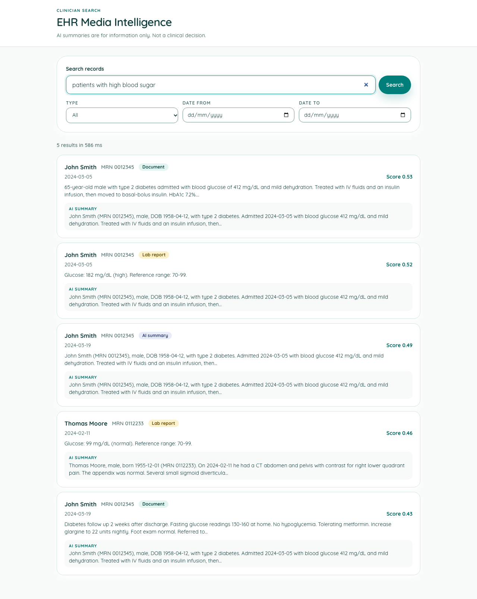
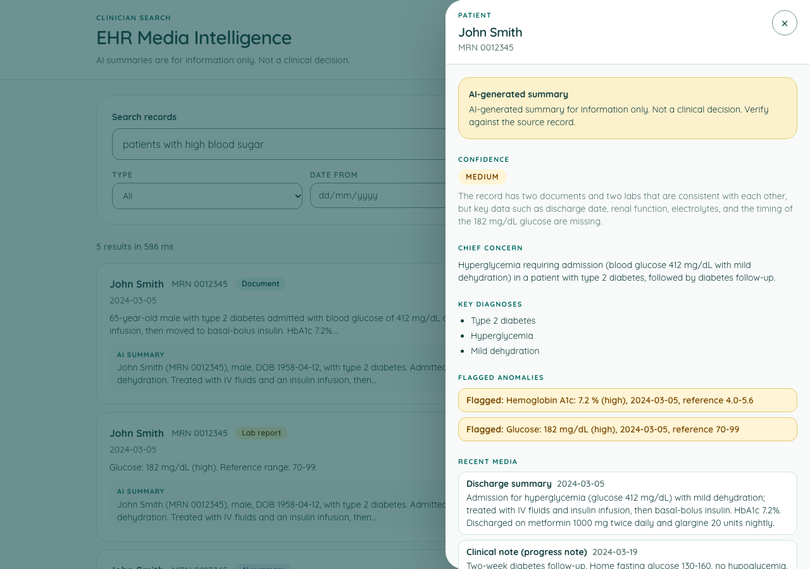
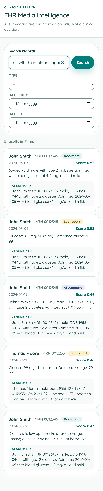
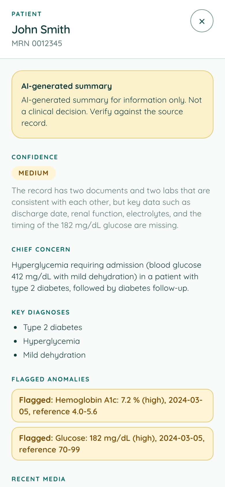

# EHR Media Intelligence Platform

Take-home assessment. All data in `data/raw/` is **100% synthetic**.

## Setup

Requires Python 3.11+.

```bash
python3.12 -m venv .venv
source .venv/bin/activate
pip install -r requirements.txt
```

## Task 1: data ingestion and cleaning

```bash
python -m app.ingestion.pipeline   # read data/raw, write data/clean, print a summary
pytest -v                          # unit tests (they do not read data/raw)
```

Inputs (`data/raw/`, problems listed in `data/raw/README.md`):
- `ehr_export.json`: Epic-style export with nested encounters, documents and labs
- `lab_results.csv`: lab rows with patient name and DOB
- `notes/*.txt`: scanned notes with a loose `Key: value` header

Outputs (`data/clean/`, git-ignored):

| File | Contents |
|---|---|
| `patients.json`, `documents.json`, `labs.json` | Cleaned records, each with its own `audit` list |
| `audit_log.jsonl` | Every change, one JSON object per line |
| `rejected.json` | Records we could not keep safely (e.g. no MRN), with the raw data |
| `conflicts.json` | Patient identity problems for human review (never auto-merged) |

Code lives in `app/ingestion/`: `loaders` → `cleaners` → `dedupe` → `pipeline`, with
models in `models.py` and the audit trail in `audit.py`.

## Task 2: FHIR mapping, validation and storage

```bash
python -m app.ingestion.pipeline   # Task 1 first: writes data/clean/
python -m app.fhir.build           # read data/clean, write data/store, print a summary
```

- Maps cleaned records to FHIR R4 resources (via `fhir.resources.R4B`): `Patient`, `Encounter`,
  `DocumentReference` (note text as base64 `text/plain`) and `DiagnosticReport` (one per lab).
- Builds one `Bundle` (type `collection`) per patient; resources reference each other with `urn:uuid` fullUrls.
- Patients in an `MRN_CONFLICT` get no bundle and are listed as "held for review".
- Validates every resource through `fhir.resources` and checks every reference resolves inside its bundle.
  Only bundles that pass are stored.

Outputs (`data/store/`, git-ignored):

| File | Contents |
|---|---|
| `fhir.db` | SQLite table `bundles (mrn, bundle_json, resource_count, created_at)` |
| `validation_report.json` / `.md` | Bundles built, passed, failed, held for review, errors in plain words |

Code lives in `app/fhir/`: `mapper` → `bundle` → `validate` → `store`, run by `build`.

## Task 3: AI clinical summaries

```bash
cp .env.example .env               # then set ANTHROPIC_API_KEY (and ANTHROPIC_MODEL if you want another model)
python -m app.summaries.build      # summarize every stored bundle, print a summary
```

- Reads each patient bundle from `data/store/fhir.db`, turns it into short readable text, and asks Claude
  (default `claude-haiku-5-5`) for a structured JSON summary: chief concern, key diagnoses, recent media,
  flagged anomalies, a summary under 200 words, and a confidence level with a reason.
- The prompt only allows facts from the record ("Not documented" when missing). Bad JSON or a summary of 200+ words
  is retried once, then recorded as failed.
- Our code (not the model) sets the MRN, patient name and a fixed disclaimer on every summary.
- Quality checks per summary: under 200 words, all parts present, every flagged lab listed, disclaimer present.
- Summaries are cached in the `summaries` table, keyed by MRN + a hash of the bundle, prompt version and model.
  Re-running with unchanged data makes **0 API calls**.
- Report: `data/store/summaries_report.md`.

**Mock mode:** with no `ANTHROPIC_API_KEY`, or with `SUMMARY_MODE=mock`, summaries are built straight from the data
with no API call. Tests always use mock mode or a fake client, so `pytest` never needs a key.

If your API key is not scoped to a workspace, also set `ANTHROPIC_WORKSPACE_ID` in `.env`.

## Task 4: semantic search and API

Search documents, lab reports and AI summaries by meaning, not exact words: "high blood sugar" finds notes
that say "hyperglycemia" or "glucose 412 mg/dL". Texts are embedded locally with `all-MiniLM-L6-v2`
(sentence-transformers, no API key) and stored in ChromaDB at `data/store/chroma` (cosine distance).

```bash
python -m app.search.index             # rebuild the index from data/store/fhir.db (run after Tasks 2 and 3)
uvicorn app.api.main:app --reload      # API at http://localhost:8000, docs at /docs
python scripts/benchmark_search.py     # speed check: 50+ items, 20 queries
```

Endpoints:

| Method | Path | What it does |
|---|---|---|
| `POST` | `/search` | Body `{"query": "..."}`. Optional query params `resource_type` (`DocumentReference`, `DiagnosticReport`, `Summary`), `date_from`, `date_to` (YYYY-MM-DD). Returns the top 5 matches with a relevance score (1 − cosine distance) and `took_ms`. |
| `GET` | `/patients/{mrn}` | Full AI summary (with disclaimer) and the patient's FHIR resources. 404 if not found or held for review. |
| `GET` | `/health` | Status and number of indexed items. |

Example:

```bash
curl -X POST 'http://localhost:8000/search?resource_type=DocumentReference&date_from=2024-01-01' \
  -H 'Content-Type: application/json' \
  -d '{"query": "brain scan for memory problems"}'
```

An empty query or a bad date returns 422 with a clear message. CORS allows any `localhost` port for the Task 5 page.

## Task 5: clinician search page

```bash
uvicorn app.api.main:app --reload      # then open http://localhost:8000
```

One page served by the same FastAPI app (`frontend/index.html` + `frontend/app.js`, Tailwind Play CDN, no build step).

- Search as you type (300 ms pause) or press Enter; filter by type and date range.
- Result cards show patient, MRN, date, type badge, relevance score and the start of the AI summary.
- Click a card (or press Enter on it) to open the patient drawer: AI summary with disclaimer, confidence,
  flagged anomalies in amber/red, recent media and the linked FHIR resources.
- Keyboard and screen reader friendly: labelled inputs, live result count, cards are buttons,
  the drawer traps focus, Esc closes it, and focus returns to the card.
- Colours follow the Onye website palette and Quicksand font, darkened where needed to pass WCAG contrast.

| Desktop results | Patient drawer |
|---|---|
|  |  |

| Mobile results | Mobile drawer |
|---|---|
|  |  |
